# Patchwork

my tasks were spread across nextcloud, github issues, jira and a deck board i forgot existed. so i stitched them into one app. it's called patchwork because naming things is hard and this one was right there.

runs on android and ios. the web and macos apps are in progress rn, so expect rough edges if you poke at them. built with expo, plus a small fastapi proxy so the web version can talk to caldav without cors throwing a tantrum.

## get it

- **f-droid:** add `https://tashif.codes/fdroid/repo?fingerprint=568557c435bdf555725de95de596a90d6fa964d4bf0b71874f254cd0be7e94c9` in Settings → Repositories, refresh, install Patchwork. the fingerprint lets f-droid check the repo is really mine
- **apk:** grab it from the [latest release](https://github.com/tashifkhan/Patchwork/releases/latest)
- **ios:** build it yourself, [instructions below](#building-the-ios-app). apple wants $99 a year and i want to keep $99 a year
- **web and macos:** in progress, not shipped yet

## screenshots

### android

material you, so it wears whatever colours your wallpaper has.

<p align="center">
  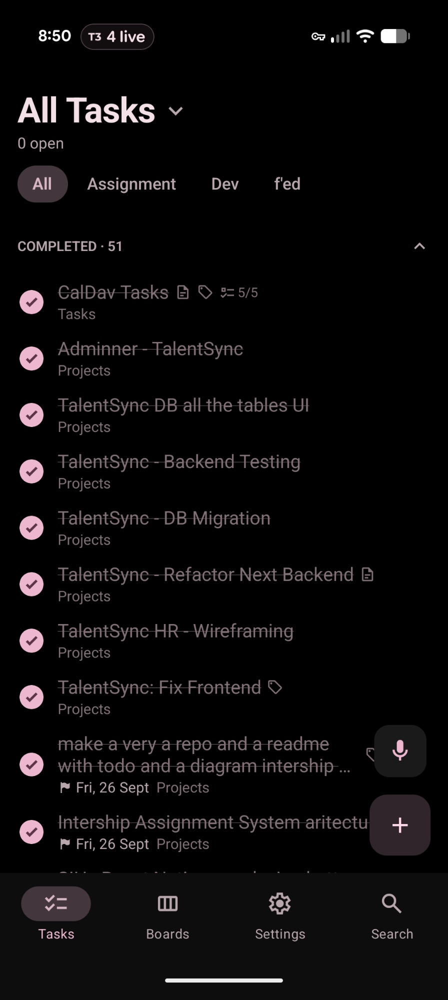
  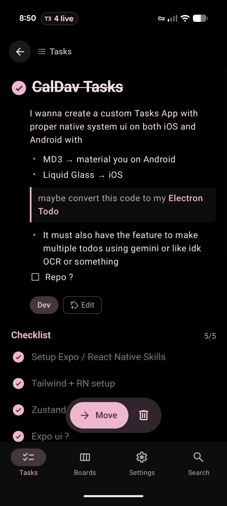
  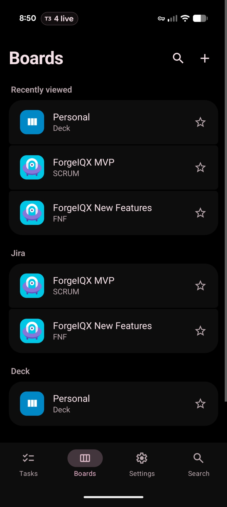
  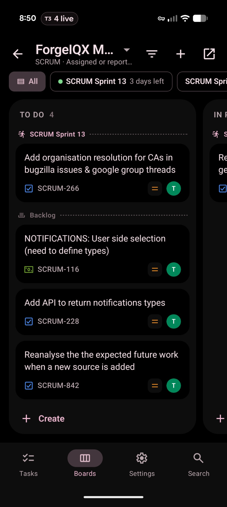
</p>
<p align="center">
  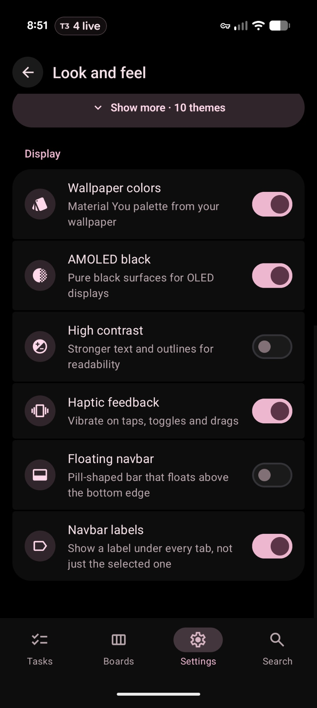
  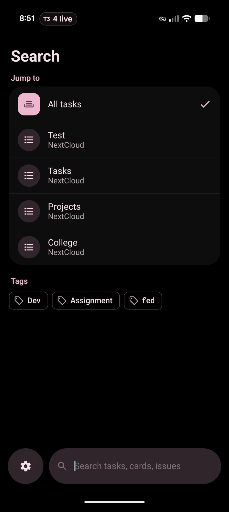
  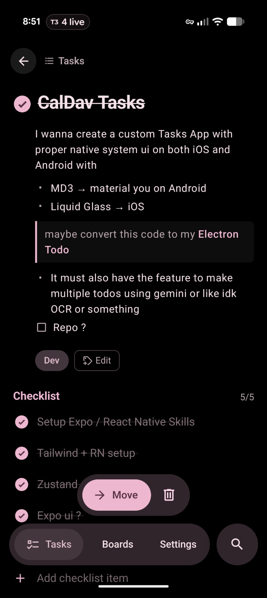
  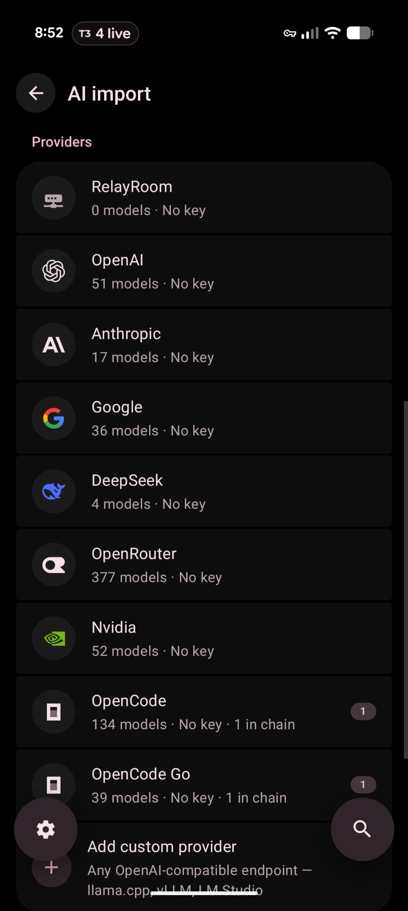
</p>

### ios

same app, ios clothes. the tasks here are demo data, my real list is too embarrassing.

<p align="center">
  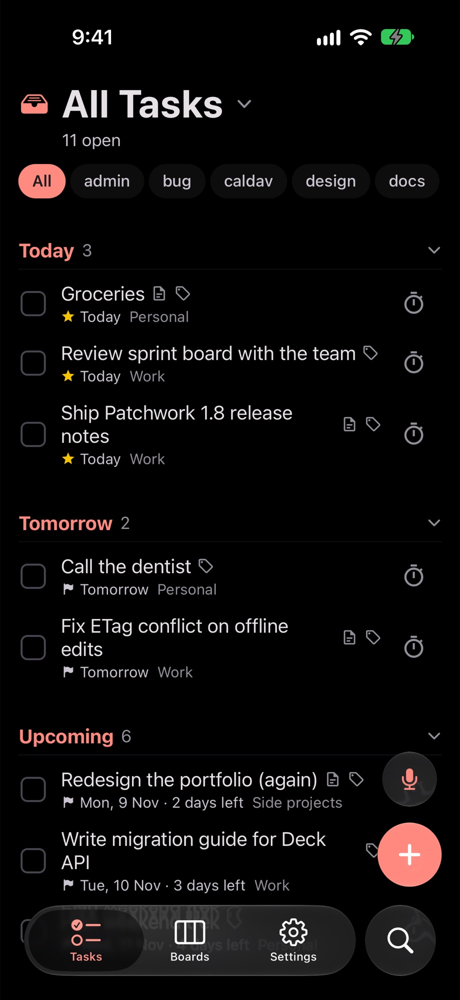
  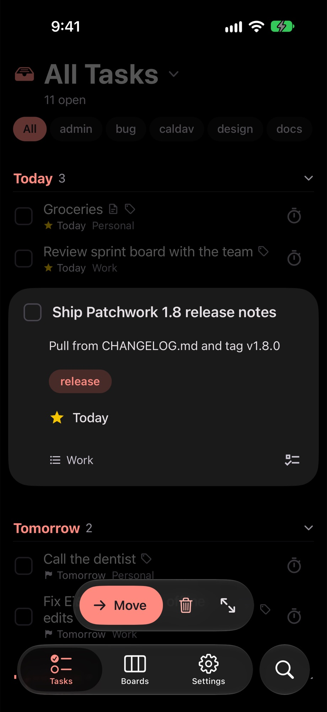
  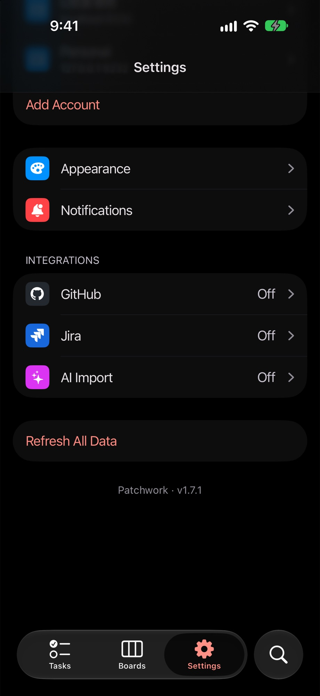
  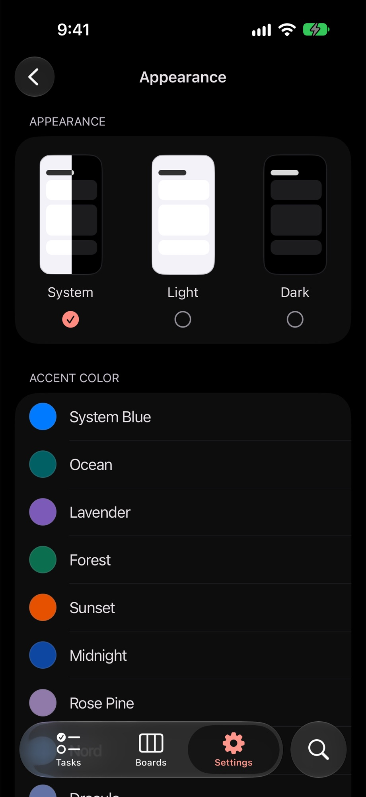
</p>

## what it stitches together

- **caldav tasks** from nextcloud or any caldav server. subtasks, tags, priorities, due dates, markdown notes, reminders. edits use ETags so two devices don't quietly overwrite each other
- **nextcloud deck** boards. drag cards around, reorder columns, create and edit everything from the app
- **jira** boards with sprints, a backlog, drag and drop that updates the rank, and a full issue editor. multiple logins, because one jira account was never going to be enough suffering
- **github issues** across repos. sign in with device flow or a token, create, close and reopen issues. multiple accounts here too
- **slack** reminders and lists. not yet. it's on the list, which is ironic

## features

- ai import. take a photo of your handwritten notes, or describe what you need, and it drafts tasks. you review them before anything gets saved, because ai should not be touching your todo list unsupervised
- bring your own model: openai, anthropic, google, deepseek, openrouter, nvidia, opencode zen, relayroom, or any openai compatible endpoint
- voice dictation
- home screen widgets on android
- material you colours on android, a custom accent on ios, high contrast, and a pure black oled mode
- tablet and foldable layouts that actually use the extra space
- a things-inspired redesign in 1.4, because of course i redesigned it

on native, your credentials and api keys stay on the device in secure storage and the app talks to your servers directly. on web, requests go through the proxy so secrets never ship to the browser.

## run it

the app uses bun:

```sh
cd app
cp .env.example .env
bun install
bun start        # then w for web, a for android, i for ios
```

the proxy uses uv:

```sh
cd proxy
uv run uvicorn main:app --reload
```

the proxy reads its nextcloud, ai and cors settings from env vars. the full list is in [`proxy/app/core/config.py`](proxy/app/core/config.py).

## building the ios app

no app store, no testflight. you need a mac with xcode and bun installed.

**in the simulator** (no apple account needed):

```sh
cd app
bun install
bun ios
```

`bun ios` runs `expo run:ios`. it generates the `ios/` project (it's gitignored), builds it and opens the simulator.

**on your actual iphone:**

1. plug in the phone and turn on developer mode (Settings → Privacy & Security → Developer Mode)
2. change `iosBundleId` in [`app/app.config.js`](app/app.config.js) to something you own, like `com.yourname.patchwork`. the default one is tied to my team, so signing will fail without this
3. build a release version onto the phone:

   ```sh
   cd app
   bun install
   bunx expo run:ios --device --configuration Release
   ```

4. if xcode complains about signing, open `app/ios/*.xcworkspace`, pick your team under Signing & Capabilities for both the app and the `ExpoWidgetsTarget` target, and run the command again

a free apple id works, but the app stops opening after 7 days and you have to build it again. a paid developer account lasts a year and also gets you `bun run eas:build:prod:ios` for cloud builds.

## where stuff lives

```text
app/          the expo app (android, ios, web)
proxy/        fastapi proxy for the web client and the ai endpoints
.github/      release and f-droid workflows
screenshots/  the pictures above
```

## roadmap

- [ ] slack integration
- [ ] linear integration
- [ ] ai that tells me why i have 40 overdue tasks (i already know why)
- [ ] actually finish the tasks in this app
